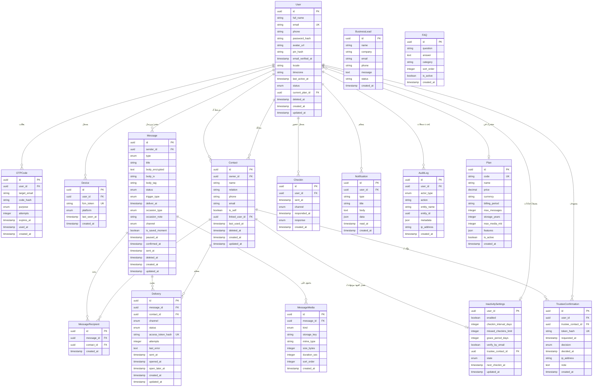

# Katalog Backend - Entity Relationship Diagram (ERD) & Relations

This document defines the relational database schema, entities, and relationship cardinality for the **Katalog** backend in Django, adapted to exclude SMS gateways, external payment gateways, and background job queues.

---

## 1. Visual Entity Relationship Diagram (Mermaid)

---

## 2. Table-by-Table Specifications & Relationships

### 1. `User` (Custom User Model)
Central user profile model.
- **Relationships**:
  - `Plan`: Many-to-One (`current_plan_id` $\rightarrow$ `Plan.id`, `null=True`, `on_delete=models.SET_NULL`).
  - `Contacts`: One-to-Many (`owner_id` in `Contact`).
  - `Messages`: One-to-Many (`sender_id` in `Message`).
  - `InactivitySettings`: One-to-One (`user_id` as Primary Key in `InactivitySettings`).
  - `Notifications`: One-to-Many (`user_id` in `Notification`).
  - `Devices`: One-to-Many (`user_id` in `Device`).

### 2. `Contact` (People Screen)
Represents recipient contacts created by users or synced from contacts.
- **Relationships**:
  - `owner`: Many-to-One $\rightarrow$ `User.id` (`on_delete=models.CASCADE`).
  - `linked_user`: Many-to-One $\rightarrow$ `User.id` (`null=True`, `on_delete=models.SET_NULL`). Enables matching recipient to an app account by email.
  - `is_self`: Boolean flag designating the "Me" recipient contact (messages to future self).

### 3. `Message` & `MessageMedia`
Stores message metadata, encrypted payload, and attached audio/image/video files.
- **Security**: `body_encrypted`, `body_iv`, and `body_tag` store AES-256-GCM encrypted content.
- **Relationships**:
  - `sender`: Many-to-One $\rightarrow$ `User.id` (`on_delete=models.CASCADE`).
  - `media`: One-to-Many $\rightarrow$ `MessageMedia.message_id` (`on_delete=models.CASCADE`).
  - `recipients`: Many-to-Many with `Contact` through `MessageRecipient`.
  - `deliveries`: One-to-Many $\rightarrow$ `Delivery.message_id`.

### 4. `MessageRecipient` & `Delivery`
Manages recipient assignment and individual delivery state per recipient.
- **Relationships**:
  - `MessageRecipient`: Join table linking `Message` and `Contact`.
  - `Delivery`: Created when message is confirmed/queued:
    - `message`: $\rightarrow$ `Message.id` (`CASCADE`).
    - `contact`: $\rightarrow$ `Contact.id` (`CASCADE`).
    - `access_token_hash`: SHA-256 hash of the 32-byte secure token used in public recipient links (`/r/:token`).

### 5. `InactivitySettings`, `Checkin`, `TrusteeConfirmation`
The proof-of-life / inactivity switch engine.
- **Relationships**:
  - `InactivitySettings`: One-to-One with `User` (`primary_key=True`).
  - `trustee_contact`: Many-to-One $\rightarrow$ `Contact.id` (`null=True`, `on_delete=models.SET_NULL`).
  - `Checkin`: Many-to-One $\rightarrow$ `User.id` (tracks user "I'm fine" responses).
  - `TrusteeConfirmation`: Many-to-One $\rightarrow$ `User.id` and `Contact.id` (stores trustee approval/rejection audit trail).

### 6. `Plan` (Informational / Tier Model)
Stores plan configurations (Free, Monthly, One-Time, Business) without payment gateway hooks:
- Limits stored as columns (`max_messages`, `storage_years`, `max_media_mb`, `features` JSON).

### 7. `Notification` & `Device`
- `Notification`: In-app notification center (bell icon).
- `Device`: FCM push notification device tokens per user (`platform` in `ios, android, web`).

### 8. `AuditLog`, `BusinessLead`, `FAQ`
- `AuditLog`: Immutable log of sensitive operations (message releases, trustee approvals, deletions).
- `BusinessLead`: Lead capture for B2B/Business plans.
- `FAQ`: Help center questions and answers.

---

## 3. Database Indexes

| Table | Index Columns | Purpose |
| :--- | :--- | :--- |
| `User` | `email`, `last_active_at` | Quick authentication lookups & inactivity checks |
| `Contact` | `(owner_id, name)`, `(owner_id, last_used_at)` | Fast search & "People you chose before" |
| `Message` | `(sender_id, status)`, `(status, deliver_at)` | Filter by status and on-demand delivery evaluation |
| `Delivery` | `access_token_hash`, `(contact_id, status)` | Instant lookup for public recipient links & inbox |
| `InactivitySettings` | `(state, next_checkin_at)` | Query-time evaluation of pending check-ins & releases |
| `Notification` | `(user_id, read_at)` | Unread notifications count query |

---

## 4. Relationship Cardinality & Rationale (Why 1-to-N or 1-to-1?)

This section details the explicit business domain, architectural, and data integrity reasons why each relationship was modeled with its specific cardinality.

### Summary Matrix

| Parent Table | Child Table | Foreign Key | Cardinality | Why this Cardinality? |
| :--- | :--- | :--- | :---: | :--- |
| **`User`** | **`Message`** | `sender_id` | **`1 : N`** (One-to-Many) | A user authors multiple messages over time (advice to children, love letters, wedding notes, reminders to future self). Each message has strictly **one author/sender**. |
| **`User`** | **`Contact`** | `owner_id` | **`1 : N`** (One-to-Many) | Each user curates their own private recipient list (family, friends, trustees). Contacts belonging to User A must never leak into or be seen by User B. |
| **`User`** | **`Device`** | `user_id` | **`1 : N`** (One-to-Many) | A user can install and run the app on multiple physical devices (iPhone, iPad, tablet). Push notifications (FCM) must reach **all** logged-in devices simultaneously for check-ins. |
| **`User`** | **`OTPCode`** | `user_id` (nullable) | **`1 : N`** (One-to-Many) | A user triggers verification at different points (registration, password reset, recipient unlock). Each attempt has its own expiration timestamp, attempt count, and security lifecycle. |
| **`User`** | **`InactivitySettings`** | `user_id` (PK=FK) | **`1 : 1`** (One-to-One) | A user has exactly **one** global proof-of-life configuration (their global check-in interval, grace period, and designated trustee). Modeling as 1-to-1 enforces uniqueness and avoids conflicting switch policies. |
| **`User`** | **`Checkin`** | `user_id` | **`1 : N`** (One-to-Many) | The proof-of-life system prompts the user repeatedly ("Where have you been? Everything OK?"). An immutable historical log of every "I'm fine" tap is preserved across weeks, months, or years to prevent false release disputes. |
| **`User`** | **`TrusteeConfirmation`** | `user_id` | **`1 : N`** (One-to-Many) | When an inactivity event triggers, a trustee confirmation request is dispatched. If the user cancels the sequence and goes inactive again later, a **new** confirmation cycle starts. Each cycle requires its own token, IP, and audit record. |
| **`User`** | **`Notification`** | `user_id` | **`1 : N`** (One-to-Many) | In-app alerts accumulate over time in the bell tray (delivery confirmations, check-in prompts, recipient opened alerts). |
| **`User`** | **`AuditLog`** | `user_id` (nullable) | **`1 : N`** (One-to-Many) | Every security-critical action (PIN reset, trustee assignment, message encryption, account soft-delete) appends an immutable audit entry. |
| **`Plan`** | **`User`** | `current_plan_id` | **`1 : N`** (One-to-Many) | A subscription tier (Free, Monthly, Business) is a shared template. Thousands of users belong to the same plan tier, but each user is subscribed to **one** active plan at a time. |
| **`Message`** | **`MessageMedia`** | `message_id` | **`1 : N`** (One-to-Many) | A single message can contain multiple attachments (e.g., 1 audio memo + 2 images + 1 video). Separate media rows allow independent upload progress, storage quota tracking, and signed URL generation without bloating the message record. |
| **`Message`** | **`MessageRecipient`** | `message_id` | **`1 : N`** (One-to-Many) | Part of the **`N : M`** relationship between Messages and Contacts. One message can be addressed to multiple family members, and one contact can receive multiple messages over their lifetime. |
| **`Contact`** | **`MessageRecipient`** | `contact_id` | **`1 : N`** (One-to-Many) | Joins a contact to all messages where they are designated as a recipient. |
| **`Message`** | **`Delivery`** | `message_id` | **`1 : N`** (One-to-Many) | **Crucial state separation:** When a message is addressed to 3 people, each recipient has an independent delivery lifecycle (Person A opened it immediately, Person B chose "Open Later", Person C hasn't opened yet). Each recipient also needs an individual, secure, single-use public link token (`access_token_hash`). |
| **`Contact`** | **`Delivery`** | `contact_id` | **`1 : N`** (One-to-Many) | Over time, the same contact (e.g., "Mother") can receive multiple distinct messages from the user across different occasions. |
| **`Contact`** | **`InactivitySettings`** | `trustee_contact_id` | **`N : 1`** (Optional Many-to-One) | A user designates **at most one** contact from their address book to serve as their trusted verifier (can be null if the user chooses release by grace period alone). |
| **`User`** | **`Contact`** | `linked_user_id` (nullable) | **`N : 1`** (Optional Many-to-One) | If a recipient contact's email matches an active user account in the system, it links to that User so messages can appear directly in their in-app `/inbox`. Multiple users can have contacts pointing to the same registered person. |

